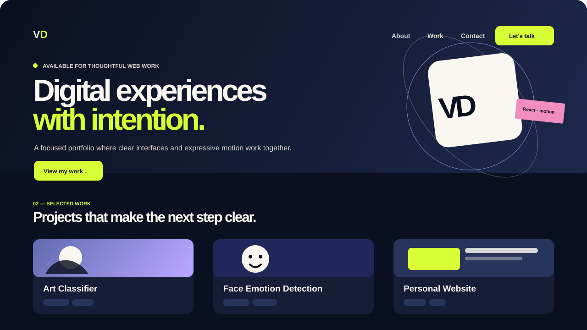

# Vincent Dancel — Portfolio v1

A responsive personal portfolio built for the Q2 Portfolio v1 brief. It introduces the developer, showcases selected work, and provides clear ways to get in touch. The app is structured with reusable React components and React Router so individual project case studies can grow beyond the landing page.

> Project note: source buttons lead to verified public repositories. The interactive project previews are part of this portfolio; add independently deployed demos when they are available.

## Preview



The visual preview is a local project asset at `public/portfolio-preview.svg`. It is intentionally checked into the project so the README preview works on GitHub once the repository is pushed.

## What is included

- A focused hero with a call to action
- About, projects, contact, and footer sections
- Reusable project-card components and accessible external links
- Client-side routing for the home page and internal project case studies
- Mobile-first responsive styling
- GSAP entrance and/or scroll-triggered motion with reduced-motion support

Project-card links follow a deliberate policy: external destinations point only to public URLs that have been checked during implementation; work without an independently hosted demo uses an internal case-study route instead. This avoids presenting made-up repository or demo links.

## Tech stack

- [React](https://react.dev/)
- [Vite](https://vite.dev/)
- [React Router](https://reactrouter.com/)
- [GSAP](https://gsap.com/)
- Plain CSS, organized by component and responsive from small screens upward

## Run locally

### Prerequisites

- Node.js 20 LTS or newer
- npm 10 or newer

### Installation

```bash
npm install
npm run dev
```

Vite prints the local address in the terminal (normally `http://localhost:5173`).

### Production check

```bash
npm run build
npm run preview
```

`npm run build` must finish successfully before deploying. Its production files are written to `dist/`.

## Deployment

This project is ready to deploy as a Vite static site on Vercel or Netlify. Detailed, provider-specific instructions—including the SPA rewrite needed for direct case-study URLs—are in [DEPLOYMENT.md](./DEPLOYMENT.md).

**Live URL:** Intentionally pending the first Vercel or Netlify production deployment. Add the confirmed URL here once it is live.

## Suggested meaningful commit history

The course brief requires at least ten meaningful commits. Keep implementation changes in reviewable slices, for example:

1. `chore: scaffold Vite React portfolio`
2. `chore: add router and global CSS foundation`
3. `feat: build responsive hero section`
4. `feat: add about and contact components`
5. `feat: create reusable project card component`
6. `feat: add project data and case-study routes`
7. `feat: add GSAP entrance animations`
8. `fix: improve mobile layout and keyboard focus states`
9. `docs: add README preview and setup guide`
10. `docs: add deployment instructions and launch checklist`

Do not manufacture commits solely to reach a count; each commit should represent a coherent, working change.

## Before submitting

- Push the repository to a public GitHub remote with the required name.
- Confirm every public GitHub, demo, email, and social link in the rendered site.
- Deploy to Vercel or Netlify, then add the real production URL above.
- Share that live URL in the class channel and link the repository from the GitHub profile.
